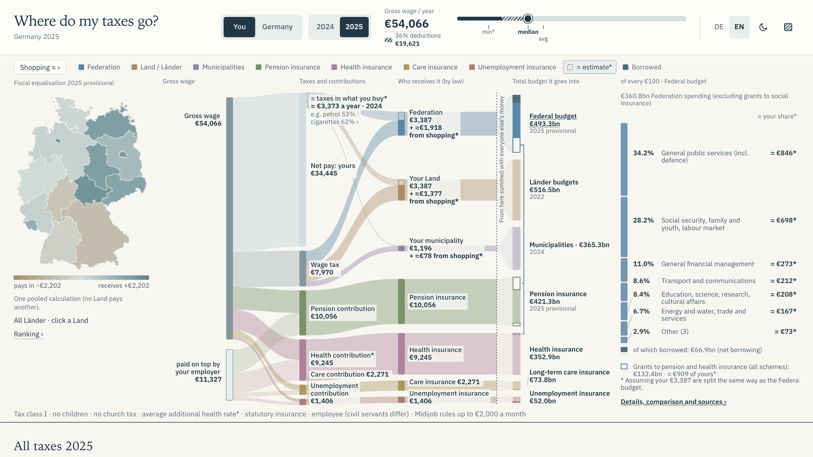

<h1 align="center">Where do my taxes go?</h1>

<p align="center">
Everyone should be able to see where their taxes go. And AI does the tedious work of bringing dozens of official sources together. One page makes them easier to explore, understand and question.
</p>

<p align="center">
  <a href="https://ax6.github.io/where-is-the-tax/#lang=en"><strong>Explore in English →</strong></a>
  &nbsp; · &nbsp;
  <a href="https://ax6.github.io/where-is-the-tax/#lang=de"><strong>Auf Deutsch entdecken →</strong></a>
</p>

<p align="center">
  <a href="https://github.com/Ax6/where-is-the-tax/actions/workflows/ci.yml"></a>
  &nbsp;
  <a href="research/README.md">How the data works</a> ·
  <a href="ROADMAP.md">Project status</a> ·
  <a href="#run-locally">Run locally</a> ·
  <a href="#contribute">Contribute</a>
</p>

<p align="center">
  👌✔️ Independently fact-checked with
  
  
  
</p>

<a href="https://ax6.github.io/where-is-the-tax/#lang=en&y=2025&theme=light">
  
</a>

<p align="center"><sub>The live explorer · 2025 view · captured 13 October 2026 · click to explore</sub></p>

Your payslip shows what comes out. Understanding what happens next takes a map.

**Where is the tax?** brings German taxes, social contributions, government budgets and their sources
onto one page. Start with a salary, follow the flows, select a Land, and open the numbers that make
you curious. Switch to Germany to see the public finances at national scale.

The aim is simple: anyone should be able to understand the picture, in German or English,
without first learning how to read a government budget.

## Follow the money

| Start with a question | Try this |
| :--- | :--- |
| **What comes out of my salary?** | Move the wage slider in **You**. See net pay, wage tax, social contributions and what your employer pays on top. |
| **Who receives it?** | Follow the coloured flows to the Federation, Länder, municipalities and social-insurance funds. Select a Land on the map. |
| **What does a budget spend it on?** | Select a budget. Read its spending as **“of every €100”**, then open a category for detail and sources. |
| **What about the tax in my shopping?** | Open **Shopping** for purchase examples and a household estimate, visibly marked `≈` and `*`. |
| **How does this look for Germany?** | Switch to **Germany**, explore the tax table and time series, and compare the available 2024 and 2025 figures. |

German and English throughout. Light and dark themes. Patterns alongside colour. Keyboard controls,
mobile layouts and a readable fallback without JavaScript. The current view is encoded in the URL,
so you can share a particular salary, year or Land.

## The line that matters

**A tax has a recipient. A budget has many sources of income.**

The chart marks the point where your contribution joins a public budget. Beyond that line,
the spending breakdown describes the budget as a whole. “Your share” is a proportional illustration:
what your contribution would look like if it followed that budget’s spending mix.

That distinction is part of the visual: taxes and social insurance stay separate, transfers between
public bodies are accounted for, and borrowing is visible. The
[method behind the comparisons](docs/research/RATIONALIZATION.md) explains the arithmetic and its limits.

## Open the evidence

The research lives in this repository, alongside the page it supports.

```text
Official publications     →  Saved sources & extracts  →  Rebuilt datasets  →  Interactive page
Destatis, BMF, Eurostat…     research/                    data/               src/
                             URLs, dates, checksums       figures + provenance
```

| Evidence | Where to look |
| :--- | :--- |
| **Primary sources** — Destatis, the Federal Ministry of Finance, Eurostat, social-insurance bodies, Berlin, the European Commission and statutory texts | [Source catalogue](docs/research/SOURCE_CATALOG.md) |
| **Traceable figures** — source files, retrieval dates, SHA-256 checksums and table, page or statute coordinates | [Research workflow](research/README.md) · [Download manifest](research/raw/MANIFEST.json) |
| **Reproducible transformations** — scripts turn raw material and committed extracts into the JSON consumed by the page | [Build scripts](scripts/research/) · [Dataset index](data/README.md) |
| **Arithmetic checks** — totals reconcile within documented rounding tolerances; the payslip tests include 121 official BMF wage-tax examples | [Reconciliation checks](scripts/research/check.py) · [Payslip tests](tests/payslip.test.ts) |
| **Review history** — independent agent reviews, re-derivations, corrections and unresolved questions | [Research logs](docs/research/logs/) |

### Read the labels

`≈` means an estimate. `*` flags an assumption or a contestable interpretation. Years and provisional
statuses remain attached to their figures; selecting 2025 does not turn an older publication into 2025 data.

The payslip uses a stated employee scenario: tax class I, no children, no church tax, statutory
insurance and an average additional health-insurance rate. Household shopping taxes use survey
averages and assumptions. Both are explained in the page’s detail panels.

### What is still missing

The explorer is live, with a reproducible data pipeline and automated arithmetic, interaction and
accessibility checks. As recorded in the [roadmap](ROADMAP.md), external expert review and
first-time visitor testing remain open. Local detail beyond Berlin is incomplete; some spending
breakdowns use older publications, including Länder functions from 2022. The roadmap tracks the
remaining work and source limitations.

## Run locally

You need **Node.js 22.12+** and npm. The prepared datasets are already in the repository.

```sh
git clone https://github.com/Ax6/where-is-the-tax.git
cd where-is-the-tax
npm ci
npm run dev
```

Open the local URL printed by Vite. The page uses **TypeScript, D3 and SVG**, built with **Vite**;
salary calculations run in the browser. No backend or API keys are needed to run the explorer.

<details>
<summary><strong>Checks, production build and deployment</strong></summary>

Python 3 is also required for the research checks; CI uses Python 3.12.

```sh
npm run typecheck
npm test
npm run check:data
npm run build
npx playwright install chromium
npm run test:a11y
```

The browser suite checks interactions, keyboard behaviour and accessibility with Playwright and
axe-core. On Linux, use `npx playwright install --with-deps chromium` to install browser system dependencies.

`npm run preview` serves the production build locally. The
[GitHub Actions workflow](.github/workflows/ci.yml) runs the checks and deploys `main` to
**GitHub Pages**. Production assets default to `/where-is-the-tax/`; set `BASE_PATH` when building
for a different hosting path.

</details>

<details>
<summary><strong>Rebuild the research datasets</strong></summary>

The full research workflow also uses Python and document-extraction dependencies:

```sh
python3 -m venv .venv
.venv/bin/python -m pip install pypdf openpyxl pdfplumber
.venv/bin/python -I scripts/research/fetch.py
.venv/bin/python -I scripts/research/fetch.py --verify
.venv/bin/python -I scripts/research/build_all.py
```

Fetching downloads source material and updates the manifest. Rebuilding regenerates datasets and
research documentation, then runs reconciliation checks. Review the resulting diff: upstream
publications can change. See the [research guide](research/README.md) for storage, provenance and
reference-year conventions.

</details>

## Contribute

**A confusing chart or a number you cannot verify is a useful bug report.**

Use [issues](https://github.com/Ax6/where-is-the-tax/issues) for questions, corrections and proposals.
For a data issue, include the figure, year, view and primary source if you have one. For an interface
issue, share the page URL and explain what you expected to understand.

| You can help with… | A good first contribution |
| :--- | :--- |
| Research | Re-derive a figure from its official source, document a discrepancy, or add missing local data. |
| Language | Improve a German or English label without losing its fiscal meaning. |
| Design and accessibility | Try the page on a phone or with a keyboard; identify where the explanation breaks down. |
| Development | Pick an open item from the [roadmap](ROADMAP.md), reproduce the issue and make a focused change. |

For data changes, start with the source registry and build scripts; regenerate the artifacts in
`data/`. Keep provenance, year labels and estimate markers intact, and run the relevant checks above.

## Related work and reuse

This project belongs to a wider tradition of making public finances understandable:
[OpenSpending](https://github.com/openspending/openspending),
[OffenerHaushalt](https://github.com/okfde/offenerhaushalt.de) and the visual explanations of
[Our World in Data](https://github.com/owid/owid-grapher) are useful reference points.
The [prior-art notes](docs/research/PRIOR_ART.md) record the project’s fiscal-transparency influences.

Source datasets have their own reuse terms and attribution requirements; see
[data licences](DATA_LICENSES.md). The repository does not currently declare a project-wide
software licence. The bundled IBM Plex Sans font includes its [Open Font License](src/assets/fonts/ibm-plex-sans-OFL.txt).
